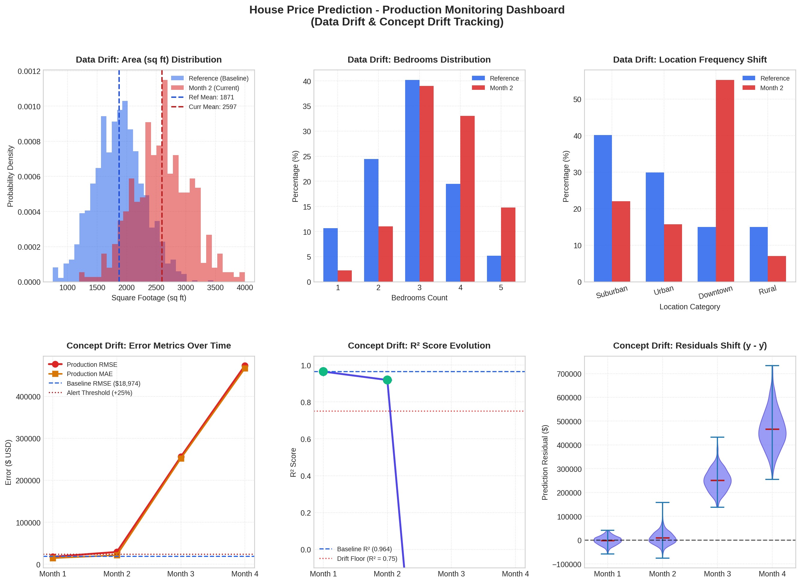

# House Price Prediction Model Monitoring System

[](https://www.python.org/)
[](https://scikit-learn.org/)
[](https://scipy.org/)
[]()

A comprehensive, production-grade monitoring system for a deployed House Price Prediction Model that detects **Data Drift**, **Concept Drift**, and automatically generates **Visual Dashboards** and **Executive HTML Reports**.

---

## 1. Project Overview

In production machine learning systems, silent performance degradation occurs over time due to two fundamental phenomena:
- **Data Drift (Covariate Shift)**: Shifts in the input feature distribution $P(X)$ over time while the underlying relationship to target $P(y|X)$ remains constant.
- **Concept Drift**: Shifts in the mathematical relationship between input features and target variable $P(y|X)$ over time, even if feature distributions remain unchanged.

This project delivers an automated, zero-heavy-dependency monitoring system that detects both forms of drift across sequential production windows and provides actionable remediation signals.

---

## 2. Dataset & Data Synthesis Methodology

### Dataset Architecture
To evaluate temporal drift monitoring realistically, an MLOps pipeline requires both historical baseline data and sequential production stream batches across time:

* **Reference (Baseline) Dataset**: 1,500 historical property transaction records used for model training and baseline calibration.
* **Production Stream Batches**: 1,600 property records collected across 4 sequential production windows ($N = 400$ per month), simulating distinct real-world market dynamics:
  - **Month 1 (Normal Production)**: In-distribution baseline traffic following reference statistics.
  - **Month 2 (Data Drift)**: Structural market shift towards larger properties (`area` shifts from $\mu=1,850$ to $\mu=2,600$ sq ft; `location` transactions concentrate heavily in Downtown and Suburban). Pricing relationship remains constant.
  - **Month 3 (Concept Drift)**: Macroeconomic real estate inflation where cost per sq ft rises by $+45\%$ and location premiums shift. Feature distributions revert to normal baseline, but model accuracy degrades drastically due to invalid learned weights.
  - **Month 4 (Compound Drift)**: Simultaneous severe data drift and concept drift.

### Feature Schema
| Feature | Data Type | Description |
|---|---|---|
| `area` | Numeric (Continuous) | Finished living space in square feet (sq ft) |
| `bedrooms` | Numeric (Discrete) | Total bedroom count (1 to 5) |
| `bathrooms` | Numeric (Discrete) | Total bathroom count (1 to 5) |
| `age` | Numeric (Continuous) | Age of property in years |
| `location` | Categorical | Geographic sector (`Downtown`, `Urban`, `Suburban`, `Rural`) |
| `price` (Target) | Numeric (Continuous) | Sale price in USD ($) |

---

## 3. Model Training & Pipeline Architecture

### Training & Validation Split
- **Total Records**: 1,500 reference samples
- **Split Ratio**: $75\%$ Training ($1,125$ samples) and $25\%$ Validation Holdout ($375$ samples) with fixed `random_state=42`.

### Preprocessing & Regressor Pipeline
The model is constructed as a Scikit-Learn `Pipeline` utilizing a modular `ColumnTransformer`:
- **Continuous Features**: Normalized via `StandardScaler()`.
- **Categorical Feature**: One-hot encoded via `OneHotEncoder(drop='first', sparse_output=False)`.
- **Regressor**: `GradientBoostingRegressor`
  - `n_estimators = 120` (120 boosting stages)
  - `max_depth = 4` (capturing non-linear interactions without overfitting)
  - `learning_rate = 0.08`
  - `random_state = 42`

### Baseline Out-of-Sample Evaluation
The baseline model achieves high predictive fidelity on the holdout validation set:
- **$R^2$ Score**: **0.9641** ($96.41\%$ variance explained)
- **Root Mean Squared Error (RMSE)**: **\$18,973.99**
- **Mean Absolute Error (MAE)**: **\$15,156.01**

The pipeline and baseline benchmark statistics are serialized to `models/house_price_model.pkl`.

---

## 4. Statistical Detection Framework

### 4.1 Data Drift Detection (`src/data_drift.py`)
1. **Two-Sample Kolmogorov-Smirnov (KS) Test** (Numerical Features):
   Evaluates maximum vertical divergence between reference and current empirical cumulative distribution functions:
   $$D = \sup_x |F_{ref}(x) - F_{curr}(x)|$$
   Flagged if $p < 0.05$ and effect size $D > 0.08$.

2. **Population Stability Index (PSI)**:
   Measures distributional divergence across quantile bins:
   $$\text{PSI} = \sum_{i=1}^{B} (P_{curr, i} - P_{ref, i}) \times \ln\left(\frac{P_{curr, i}}{P_{ref, i}}\right)$$
   - $\text{PSI} < 0.10$: Stable / No significant drift
   - $0.10 \le \text{PSI} < 0.25$: Moderate drift (warning)
   - $\text{PSI} \ge 0.25$: Severe drift (action required)

3. **Chi-Square Goodness-of-Fit Test** (Categorical Features):
   Assesses observed frequency deviations against expected baseline categorical distribution:
   $$\chi^2 = \sum_{k} \frac{(O_k - E_k)^2}{E_k}$$

### 4.2 Concept Drift Detection (`src/concept_drift.py`)
1. **Performance Metric Tracking**:
   Monitors percentage degradation in Root Mean Squared Error ($RMSE$) and $R^2$ score against baseline:
   $$\Delta \text{RMSE} = \frac{\text{RMSE}_{curr} - \text{RMSE}_{base}}{\text{RMSE}_{base}} \times 100\%$$
   - Warning trigger: $\Delta \text{RMSE} \ge +30\%$ or $R^2 < 0.80$
   - Critical trigger: $\Delta \text{RMSE} \ge +80\%$ or $R^2 < 0.60$

2. **Residual Error Distribution Test**:
   Two-sample KS-test on prediction residuals ($e = y - \hat{y}$) to verify whether prediction errors remain zero-mean Gaussian or develop systematic directional bias (under/over-prediction).

---

## 5. Production Batch Monitoring Results

### Feature-Level Data Drift Results (Month 2 vs Baseline)
| Feature | Type | Statistical Test | Statistic | p-value | PSI | Status |
|---|---|---|---|---|---|---|
| `area` | Numeric | Two-Sample KS | $D = 0.596$ | $1.53 \times 10^{-105}$ | $2.093$ | 🔴 **DRIFT DETECTED** |
| `bedrooms` | Numeric | Two-Sample KS | $D = 0.231$ | $3.02 \times 10^{-15}$ | $0.391$ | 🔴 **DRIFT DETECTED** |
| `bathrooms` | Numeric | Two-Sample KS | $D = 0.388$ | $5.29 \times 10^{-43}$ | $0.634$ | 🔴 **DRIFT DETECTED** |
| `age` | Numeric | Two-Sample KS | $D = 0.147$ | $1.98 \times 10^{-6}$ | $0.783$ | 🔴 **DRIFT DETECTED** |
| `location` | Categorical | Chi-Square ($\chi^2$) | $\chi^2 = 508.5$ | $6.71 \times 10^{-110}$ | $0.785$ | 🔴 **DRIFT DETECTED** |

### Concept Drift & Model Degradation Tracking
| Time Window | Scenario Description | RMSE ($) | MAE ($) | $R^2$ Score | RMSE Shift | Status |
|---|---|---|---|---|---|---|
| **Month 1** | Normal (In-distribution baseline) | $17,875 | $14,377 | **0.9648** | $-5.8\%$ | 🟢 **NORMAL / STABLE** |
| **Month 2** | Data Drift (Area & Location Shift) | $29,188 | $21,497 | **0.9192** | $+53.8\%$ | 🟡 **MODERATE WARNING** |
| **Month 3** | Concept Drift (Market Inflation Shock) | $256,097 | $251,969 | **-2.9574** | $+1249.7\%$ | 🔴 **CRITICAL CONCEPT DRIFT** |
| **Month 4** | Compound Drift (Data + Concept Shift) | $473,470 | $466,587 | **-6.3822** | $+2395.4\%$ | 🔴 **CRITICAL CONCEPT DRIFT** |

---

## 6. Visual Dashboards & Reports

The monitoring pipeline generates two comprehensive artifacts:
1. **Visual Monitoring Dashboard** (`reports/monitoring_dashboard.png`):
   - 6-panel high-resolution graphic visualizing numerical and discrete feature distribution shifts, categorical frequency comparisons, metric trends over time, $R^2$ decay, and residual violin plots.
2. **Interactive HTML Executive Report** (`reports/monitoring_report.html`):
   - Fully standalone, portable HTML report with embedded Base64 graphics, drift status pills, feature scorecards, and automated remediation action plans.



---

## 7. Project Structure

```text
├── data/
│   ├── reference_data.csv        # Baseline training/holdout dataset (1,500 samples)
│   └── production_data.csv       # Production batches across 4 temporal windows (1,600 samples)
├── models/
│   ├── train_model.py            # Model training & serialization
│   └── house_price_model.pkl     # Serialized GradientBoosting pipeline artifact
├── src/
│   ├── __init__.py
│   ├── data_drift.py             # KS-Test, PSI & Chi-Square data drift detector
│   ├── concept_drift.py          # Metric tracking & residual error drift detector
│   └── visualizer.py             # Dashboard PNG & standalone HTML report generator
├── reports/
│   ├── monitoring_dashboard.png  # Multi-panel visual report
│   ├── monitoring_report.html    # Portable, interactive executive dashboard
│   └── monitoring_metrics.json   # Machine-readable metric results
├── run_monitoring.py             # Main entry point
├── requirements.txt              # Python requirements
├── document.md                   # Full assignment submission report
└── README.md                     # Engineering documentation
```

---

## 8. Quickstart & Execution

### Prerequisites
Install dependencies:
```bash
pip install -r requirements.txt
```

### Run End-to-End Monitoring Pipeline
```bash
python3 run_monitoring.py
```

### Re-Train Model from Scratch
```bash
python3 models/train_model.py
```

### View Interactive HTML Report
```bash
xdg-open reports/monitoring_report.html
# Or open directly in any browser
```
